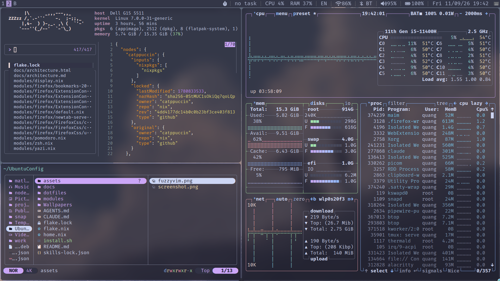

<h1 align="center">dot-ccin</h1>
<p align="center">
  <a href="https://nixos.org"></a>
  <a href="https://github.com/nix-community/home-manager"></a>
  <a href="https://i3wm.org"></a>
  <a href="https://github.com/catppuccin/catppuccin"></a>
</p>

> A keyboard-driven i3 rice for plain Ubuntu (no NixOS), themed Catppuccin Mocha end to end. One Nix flake + Home Manager command rebuilds the whole desktop (Rofi menus, Kitty, Neovim, Yazi, Firefox, Vietnamese input), and dotfiles are symlinked so edits apply instantly.


[demo.webm](https://github.com/user-attachments/assets/84f04267-aeff-49eb-a212-983af98ae4b9)




## Screenshots

| Clean | Busy (fastfetch + nvim + btop) |
| --- | --- |
|  |  |
| **Rofi launcher** (`Mod+space`) | **Power menu** (`Mod+x`) |
|  |  |

## What's installed

| Category | Tools |
| --- | --- |
| Window Manager | i3 (installed externally) + i3status-rust |
| Shell | Zsh + Starship |
| Terminal | Alacritty (Kitty also installed) |
| Launcher | Rofi (`Mod+space`: run / drun / ssh) |
| Quick menus | Rofi-driven power, clipboard, display, wallpaper, and pomodoro-task pickers (Wi-Fi/Bluetooth via nm-applet/blueman tray) |
| Notifications | dunst (sound + volume ducking on notify, silent volume/brightness OSD, Caps Lock state), login/logout sounds, USB plug/unplug alerts |
| File Manager | Thunar (archive plugin + xarchiver: zip/7z/rar/tar), Yazi (smart-enter, full-border, jump-to-char, git, mount plugins) |
| Browser | Firefox (Catppuccin CSS, managed extensions, custom new-tab page) |
| Editor | Neovim + fuzzyvim (`Ctrl+F` fzf file picker with preview) |
| Screenshot | maim + Satty |
| Clipboard History | cliphist |
| Input Method | Fcitx5 + Unikey |
| Multiplexer | Tmux (Catppuccin, resurrect, continuum) |
| System Monitor | Btop |
| Media | VLC, kew |
| Theme | Catppuccin Mocha, applied everywhere |
| Housekeeping | Weekly `nix store gc` via systemd timer |

## Structure

```
.
├── flake.nix       # flake inputs, user, hostMain (stateVersion, machine-specific values)
├── home.nix        # minimal Home Manager entry point
├── modules/        # focused Home Manager modules
│   └── default.nix # imports all modules
├── dotfiles/       # app configs symlinked into ~/.config
├── Wallpapers/     # wallpaper assets
├── docs/           # architecture notes
├── INSTALL.md      # step-by-step install guide
├── flake.lock      # locked dependency versions
└── README.md       # this file
```

## How to use

1. **Add a package** → edit `modules/packages.nix`
2. **Add an app config** → create `dotfiles/<app>/`, then add `"<app>"` to `configApps` in `modules/dotfiles.nix`
3. **Add Home Manager logic** → create a new file under `modules/`, import it from `modules/default.nix`
4. **Apply** → `home-manager switch --flake ".#$USER"`

Config files in `dotfiles/` are symlinked directly — edit and see changes immediately, no rebuild needed.

## Common commands

```bash
home-manager switch --flake ".#$(whoami)"     # apply config
nix flake check                               # validate before switching
nix fmt                                        # format Nix files
nix store gc                                   # clean /nix/store
```

## Install

See [INSTALL.md](INSTALL.md) for step-by-step setup and troubleshooting.

## Notes

- i3 shortcuts: `Mod+i` (see `dotfiles/i3/keyshortcuts.txt`)
- Shell aliases: `modules/zsh.nix`
- Do not commit secrets, SSH keys, browser sessions, or generated logs
- Audio: PipeWire (PulseAudio-compatible, controlled via `pactl`/`wpctl`)
- Brightness: `F6`/`F7` set 30% / 80%, media keys ±5%. Laptop panel via `brightnessctl`, external monitor via `ddcutil` (DDC/CI, needs the one-time i2c setup in [INSTALL.md](INSTALL.md#6-external-monitor-brightness-optional))
